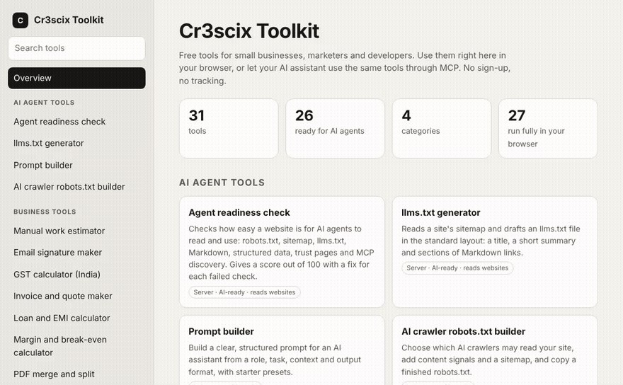
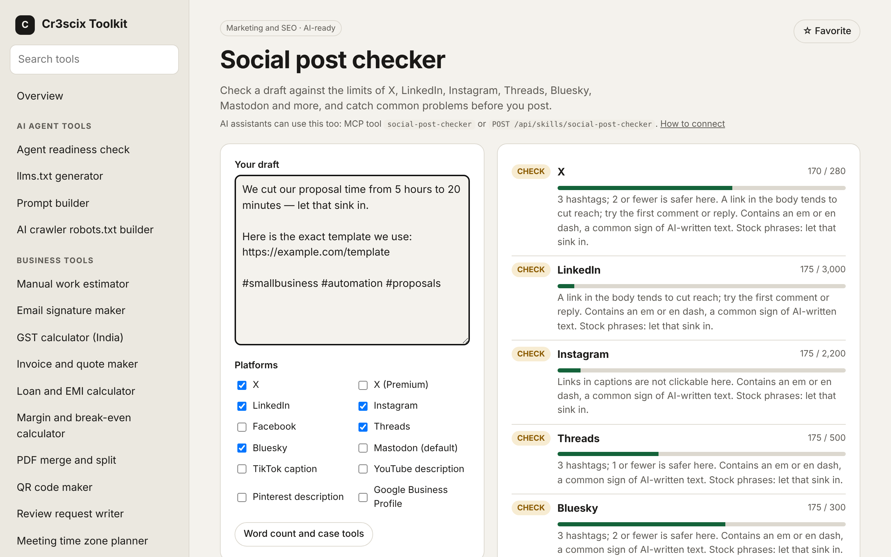
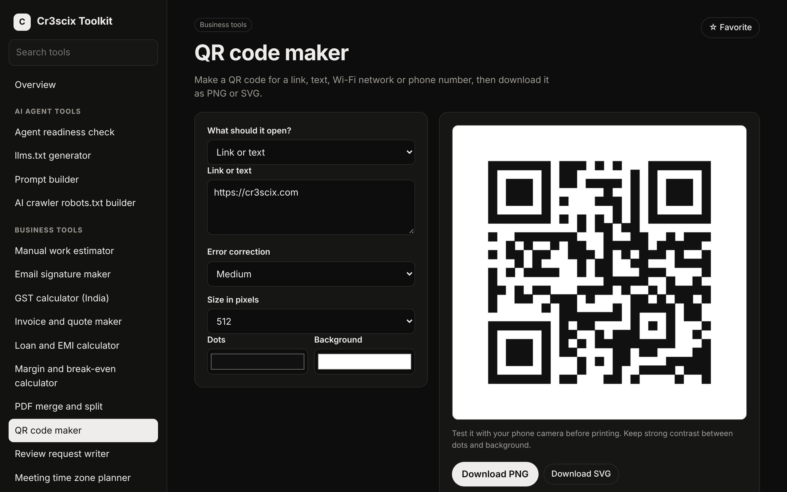

<div align="center">

# Cr3scix Toolkit

**31 free tools for small businesses, marketers and developers.<br>Use them in your browser, or let your AI assistant use them too.**

[**Try it live**](https://cr3scix.com/skills/) · [Self-host with Docker](#self-host) · [Connect your AI assistant](#for-ai-agents) · [Add a tool](CONTRIBUTING.md)

No sign-up. No tracking. Browser tools never send your files or text anywhere.



</div>

## Why this exists

Tool collections like it-tools are made for people. Agent skill collections are made for AI. Real work needs both: you check a post yourself on Monday, and on Tuesday your assistant checks fifty of them.

So every tool here works two ways:

- **For you:** a clean page in the dashboard. Fill in a form, get a result, copy or download it.
- **For your AI assistant:** the same tool over [MCP](#for-ai-agents) and a REST API, giving the same answer. 26 of the 31 tools are AI-ready today.

It is plain PHP with no database and no build step, so it runs on almost any web host, or in Docker.

## The tools

**Business**

| Tool | What it does | AI-ready |
| --- | --- | :---: |
| Invoice and quote maker | Line items and tax, print or save as PDF | ✓ |
| GST calculator (India) | Add or remove GST, with the CGST, SGST or IGST split | ✓ |
| Loan and EMI calculator | Monthly payment, total interest, year-by-year schedule | ✓ |
| Margin and break-even calculator | Margin, markup and units to break even | ✓ |
| Manual work estimator | What repetitive work costs a year, and what automation could save | ✓ |
| Review request writer | Polite messages asking happy customers for a review | ✓ |
| WhatsApp click-to-chat link | wa.me links with a ready-typed message | ✓ |
| Email signature maker | Clean HTML signatures for Gmail and Outlook | ✓ |
| Meeting time zone planner | One time across cities, with working-hours check | ✓ |
| QR code maker | Links, Wi-Fi and phone numbers as PNG or SVG | |
| PDF merge and split | Combine PDFs or pull out pages, in your browser | |

**Marketing and SEO**

| Tool | What it does | AI-ready |
| --- | --- | :---: |
| Social post checker | Limits for X, LinkedIn, Instagram, Threads, Bluesky, Mastodon and more, plus AI-sounding phrases | ✓ |
| SEO title and description preview | Length check, Google preview, ready-made meta and social tags | ✓ |
| UTM link builder | Campaign tracking links that keep reports clean | ✓ |
| Text toolkit | Word counts, reading time, case, slugs, line cleanup | ✓ |
| Carousel slide maker | Plain text to Instagram or LinkedIn slides | |
| Image resizer and compressor | Social sizes, crop, compress, in your browser | |

**Developer**

| Tool | What it does | AI-ready |
| --- | --- | :---: |
| JSON formatter and validator | Format, minify, sort keys, validate | ✓ |
| CSV and JSON converter | Both directions, quoted fields, spreadsheet-safe output | ✓ |
| Regex tester | Matches and groups, highlighted | ✓ |
| Encode, decode and JWT viewer | Base64, URL, HTML, and JWT contents | ✓ |
| ID and password generator | UUIDs, passwords and tokens from a secure random source | ✓ |
| Timestamp converter | Unix time to dates in any zone, and back | ✓ |
| Text diff | Line-by-line differences | ✓ |
| Color contrast checker | WCAG AA and AAA results | ✓ |
| JSON-LD business generator | schema.org markup for a business | ✓ |
| Cron expression helper | Plain-words meaning and the next run times | |

**AI agents and websites**

| Tool | What it does | AI-ready |
| --- | --- | :---: |
| Agent readiness check | Scores how easy a website is for AI agents to use, with a fix for every failed check | ✓ |
| llms.txt generator | Drafts an llms.txt from your sitemap | ✓ |
| AI crawler robots.txt builder | Choose which AI crawlers may read your site, with content signals | ✓ |
| Prompt builder | Clear, structured prompts from a role, task and format | ✓ |

<p align="center">
  
  
</p>

## For AI agents

**MCP:** add `https://cr3scix.com/skills/mcp` (or your own copy's `/mcp`) as a remote MCP server in any client that supports Streamable HTTP. Every AI-ready tool shows up as a tool. A server card lives at `/.well-known/mcp/server-card.json` and an index at `/llms.txt`.

**REST:**

```bash
curl -X POST https://cr3scix.com/skills/api/skills/gst-calculator \
  -H "Content-Type: application/json" \
  -d '{"amount": 1180, "mode": "remove"}'
```

`GET /api/skills` lists every tool with its input schema.

**Agent Skills:** [`agent-skills/`](agent-skills/) holds portable skills in the open [Agent Skills format](https://agentskills.io/specification). The first is [`social-media`](agent-skills/skills/social-media/SKILL.md): plan, write, repurpose, review and audit posts for any brand on 12 platforms, with a post checker. In Claude Code:

```
/plugin marketplace add cr3scix/toolkit
/plugin install cr3scix-toolkit@cr3scix
```

Or copy the folder into your agent's skills directory.

## Self-host

**Docker:**

```bash
git clone https://github.com/cr3scix/toolkit.git && cd toolkit
docker compose up -d
# open http://localhost:8080
```

**Any PHP host** (PHP 8.1+ with curl and mbstring): upload the folder or connect the repo with your host's Git deploy. Apache and LiteSpeed use the included `.htaccess`. Works in a subfolder too.

**Locally:** `php -S 127.0.0.1:8080 index.php`

| Setting | Default | Meaning |
| --- | --- | --- |
| `SKILLS_ENABLE_NETWORK` | on | Turn off the tools that fetch other websites |
| `SKILLS_RATE_GENERAL` | 60 | Requests per minute per visitor |
| `SKILLS_RATE_NETWORK` | 10 | Website-fetching runs per minute per visitor |
| `SKILLS_TRUST_CLOUDFLARE` | off | Use the real visitor IP for rate limits behind Cloudflare |
| `SKILLS_BASE_URL` | auto | Public address, if auto-detection gets it wrong |

Set these as environment variables or in `config.php` (copy `config.example.php`).

## Privacy and safety

- Browser tools run entirely on your device. Files you resize, merge or convert are never uploaded.
- The server stores nothing about visitors. Favorites and recent runs stay in your own browser.
- Tools that fetch websites can only reach public addresses, check every redirect, cap response sizes and are rate limited. Set `SKILLS_ENABLE_NETWORK=0` if you don't want visitors triggering outbound requests from your server.
- Report security problems privately: see [SECURITY.md](SECURITY.md).

## Languages

The interface is available in English, தமிழ் and हिन्दी. Tamil and Hindi were drafted by AI and need native review; [corrections welcome](CONTRIBUTING.md#translations).

## Contributing

A new tool is one folder. `php scripts/new-app.php my-tool "My tool" business --agent` scaffolds it. See [CONTRIBUTING.md](CONTRIBUTING.md), and the [roadmap](ROADMAP.md) for what's next.

## License

MIT. Bundled libraries keep their own licenses: [qrcode-generator](apps/qr-code/vendor/LICENSE.md) and [pdf-lib](apps/pdf-tools/vendor/LICENSE.md), both MIT.

Made by [Cr3scix](https://cr3scix.com) in Chennai.
